# 🕸️ ALICE — GRAPHE DE DÉPENDANCES DES FONCTIONNALITÉS (MISSION 008)

**Mission ID :** `ALICE-ULTIMATE-INTELLIGENCE-AND-AUTONOMY-IMPLEMENTATION-008`  
**Date :** 24 Novembre 2026  

---

## 1. GRAPHE GLOBAL DES DÉPENDANCES ARCHITECTURALES

```mermaid
flowchart TD
    subgraph W0 ["WAVE 0 : FOUNDATION & GOVERNANCE"]
        FF["FeatureFlags Registry"]
        AUD["AuditLogger (Secret Redaction)"]
        EVT["EventBus / Lifecycle Contracts (007)"]
    end

    subgraph W1 ["WAVE 1 : CORE VOICE, RBAC & OPS"]
        F28["28. Multi-User RBAC & Guest Mode"]
        F30["30. Observability & Diagnostics"]
        F01["01. Real-Time Barge-In"]
        F04["04. Whisper Mode"]
        F05["05. Follow-Up Listen"]
    end

    subgraph W2 ["WAVE 2 : MEMORY & DOCUMENT INTELLIGENCE"]
        F11["11. Hybrid Vector + BM25 RAG"]
        F12["12. Personal Knowledge Graph"]
        F13["13. Hot-Folder Watchdog"]
        F14["14. Executive Briefing"]
        F15["15. Commitment Tracker"]
    end

    subgraph W3 ["WAVE 3 : PREDICTIVE DOMOTICS & IoT"]
        F06["06. Predictive Routines"]
        F07["07. Eco-Manager"]
        F08["08. Self-Healing IoT"]
        F09["09. Presence Simulation"]
        F10["10. Smart Thermal Comfort"]
    end

    subgraph W4 ["WAVE 4 : VISION, OCR & SAFETY ZONES"]
        F16["16. On-Demand Visual Analysis"]
        F17["17. Smart OCR Receipts"]
        F18["18. Intelligent RTSP Sentinel"]
        F19["19. Visual Memory"]
        F20["20. Contextual Safety Zones"]
    end

    subgraph W5 ["WAVE 5 : ORCHESTRATION & AUTOMATION"]
        F24["24. Long-Running Jobs"]
        F22["22. Agent Swarm (over 9-state Orch)"]
        F23["23. Autonomous Web Agent"]
        F25["25. Universal Webhook Connector"]
        F21["21. Morning / Evening Briefings"]
    end

    subgraph W6 ["WAVE 6 : BIOMETRICS, MOBILE & VAULT"]
        F29["29. Encrypted AES-256-GCM Vault"]
        F02["02. Voice ID / Multi-Speaker"]
        F03["03. Acoustic Mood Context"]
        F26["26. Resilient Offline PWA"]
        F27["27. Home Screen Shortcuts"]
    end

    FF --> F28
    AUD --> F28
    EVT --> F30
    F28 --> F30
    F01 --> F04
    F01 --> F05
    F28 --> F05

    F28 --> F11
    F28 --> F12
    F11 --> F13
    F11 --> F14
    F12 --> F15
    F14 --> F15

    F28 --> F06
    F28 --> F07
    F28 --> F08
    F28 --> F09
    F28 --> F10
    F08 --> F06

    F28 --> F16
    F16 --> F17
    F28 --> F18
    F18 --> F19
    F18 --> F20

    EVT --> F24
    F28 --> F24
    F28 --> F22
    F24 --> F22
    F28 --> F23
    F24 --> F25
    F28 --> F25
    F15 --> F21
    F08 --> F21
    F11 --> F21

    F28 --> F29
    AUD --> F29
    F01 --> F02
    F29 --> F02
    F28 --> F02
    F01 --> F03
    F28 --> F26
    F26 --> F27
    F28 --> F27
```

---

## 2. MATRICE EXPLICITE DES DÉPENDANCES CRITIQUES

| Fonctionnalité | Dépend de (Prérequis stricts) | Débloque |
| :--- | :--- | :--- |
| **01 Barge-In** | `WSSessionManager`, `parler`, `ecouter` | **02 Voice ID**, **03 Acoustic Context**, **04 Whisper**, **05 Follow-Up** |
| **02 Voice ID** | **01** (pipeline audio), **28** (RBAC), **29** (stockage chiffré des templates) | Identification multi-utilisateurs & profil automatique |
| **03 Acoustic Mood** | **01** (pipeline audio), `FeatureFlags` (`emotion_context`) | Adaptation de tonalité & concision |
| **04 Whisper Mode** | **01** (automate audio), profils TTS | Réponse nocturne basse intensité |
| **05 Follow-Up Listen** | **01** (automate audio), **28** (vérification session/rôle), WebSocket | Conversation multi-tours fluide |
| **06 Predictive Routines** | **28** (consentement OWNER), **08** (santé capteurs), historique HA | Suggestions proactives d'automatisation |
| **07 Eco-Manager** | **28** (règles critiques OWNER), API HA, tarifs configurés | Alertes pics & délestage autorisé |
| **08 Self-Healing IoT** | **28**, API HA, **30** (télémétrie intégrations) | **06 Routines**, **21 Briefings** |
| **09 Presence Simulation** | **28** (mode absence explicite), invariants sécurité alarme/serrures | Protection logement |
| **10 Smart Thermal Comfort** | **28**, capteurs HA, API météo locale | Régulation sans oscillation |
| **11 Hybrid RAG** | `alice_rag.py`, **28** (cloisonnement inter-utilisateurs) | **13 Watchdog**, **14 Briefing**, **21 Briefings** |
| **12 Knowledge Graph** | **28** (propriété/visibilité), `CrossProcessMemoryLock` | **15 Commitment Tracker**, personnalisation |
| **13 Watchdog** | **11 Hybrid RAG**, **24** (file pour gros fichiers) | Indexation continue PDF/XLSX/DOCX/MD/EPUB |
| **14 Executive Briefing** | **11 Hybrid RAG**, LLM Gateway | **15 Commitment Tracker** |
| **15 Commitment Tracker** | **12 KG**, `GOOGLE_ADAPTER`, **28** (scopes) | **21 Morning/Evening Briefing** |
| **16 Visual Analysis** | **28**, `MobileHandler` / WS image upload, LLM Vision | **17 Smart OCR Receipts** |
| **17 Smart OCR Receipts** | Tesseract 5.5 + OpenCV, **16** (flux mobile), export XLSX | Comptabilité personnelle & classement |
| **18 Video Sentinel** | OpenCV, **28**, `FeatureFlags` (`video_monitoring`) | **19 Visual Memory**, **20 Safety Zones** |
| **19 Visual Memory** | **18 Video Sentinel**, politique rétention | Recherche temporelle d'objets |
| **20 Safety Zones** | **18 Video Sentinel**, géométrie ROI | Alertes contextuelles sécurisées |
| **21 Briefings** | **15 Commitments**, **08 IoT**, `GOOGLE_ADAPTER`, **28** | Autonomie proactive |
| **22 Agent Swarm** | `alice_orchestrator.py`, **28** (droits par agent), **24 Jobs** | Délégation contrôlée |
| **23 Web Agent** | `alice_web_guard.py`, **28**, modale confirmation mobile | Automatisation web sûre |
| **24 Long-Running Jobs** | `alice_orchestrator.py`, **28**, WS notifications | **13**, **22**, **25** |
| **25 Webhooks** | **28**, **24**, validation HMAC & rejeu | Écosystème n8n / Node-RED |
| **26 Offline PWA** | `MobileHandler`, Service Worker, **28** (aucun secret en cache) | **27 Quick Actions** |
| **27 Quick Actions** | **26 PWA**, **28 RBAC**, modale de confirmation | Pilotage mobile 1-tap |
| **28 RBAC / Guest Mode** | `WSSessionManager`, `SystemActionController` | **Toute la plateforme (Waves 1 à 6)** |
| **29 Encrypted Vault** | `cryptography` AES-256-GCM, **28** (OWNER), `AuditLogger` | **02 Voice ID** (templates), secrets connecteurs |
| **30 Observability** | **28** (permission `ADMIN`/`OWNER`), `command_lifecycle.log` | Monitoring temps réel & diagnostics |
