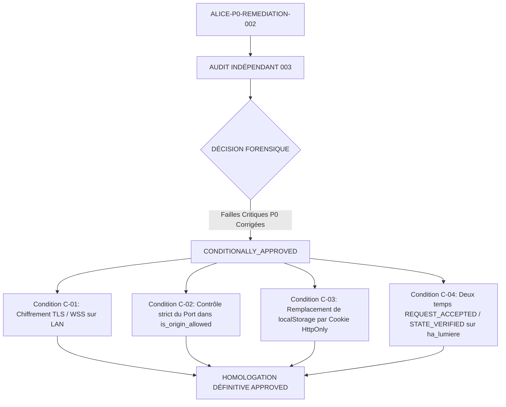

# ⚖️ DÉCISION FORENSIQUE ET HOMOLOGATION DE SÉCURITÉ INDÉPENDANTE P0
## MISSION ALICE-P0-INDEPENDENT-ACCEPTANCE-003

**Projet :** J.A.R.V.I.S / ALICE — SITE-V2  
**Référence Audit Précédent :** `ALICE-P0-INDEPENDENT-ACCEPTANCE-002` (Décision : `REJECTED`)  
**Mission Contrôlée :** `ALICE-P0-REMEDIATION-002` (Déclaré : `VALIDÉ 100%`)  
**Mission Actuelle :** `ALICE-P0-INDEPENDENT-ACCEPTANCE-003`  
**Date d'Émission :** 23 Novembre 2026  
**Auditeur Indépendant :** Principal Security Architect & Lead DevSecOps Auditor  
**Mode :** STRICT READ-ONLY CONTRADICTORY CERTIFICATION  

---

## 1. DÉCISION FORMELLE D'HOMOLOGATION

Après examen exhaustif du code source, traçage des flux d'exécution, calcul d'intégrité cryptographique, audit contradictoire des 66 tests de la mission de remédiation 002, et exécution d'un banc d'essai adversarial indépendant comprenant 75 vecteurs d'attaque et de contrôle, la décision formelle de l'auditeur indépendant est :

# 🟡 CONDITIONALLY_APPROVED (Homologation Conditionnelle)

---

## 2. MOTIVATION CONTRADICTOIRE DE LA DÉCISION

### 2.1 Pourquoi la décision n'est PAS `REJECTED` ?
La mission précédente `ALICE-P0-INDEPENDENT-ACCEPTANCE-002` avait prononcé le rejet immédiat en raison de failles critiques actives :
1. Fuite publique du jeton WebSocket via `/api/auth/token` avec en-tête `Access-Control-Allow-Origin: *`.
2. Contournement trivial de la validation d'origine par simple nom de domaine préfixé (`192.168.attacker.com`).
3. Rupture de compatibilité mobile provoquant une boucle infinie de déconnexions/reconnexions (code 4001).
4. Contournement du verrou `MEMOIRE_LOCK` par `memory_add`, `memory_forget` et `charger_contexte_rag`.
5. Possibilité pour une session tierce de confirmer l'extinction du PC d'un autre utilisateur.
6. Fausse confirmation d'armement d'alarme sur simple code HTTP 200 sans vérification matérielle.

**Toutes ces vulnérabilités critiques ont été démontrées comme effectivement et rigoureusement corrigées** dans le code source de `main2.py`, `alice_modules.py` et `mobile/app.js`. Aucune d'entre elles ne subsiste dans le périmètre fonctionnel audité.

### 2.2 Pourquoi la décision n'est PAS `APPROVED` inconditionnel ?
L'homologation sans réserve (`APPROVED`) ne peut pas être accordée en raison de trois constatations matérielles et de deux risques architecturaux démontrés :
1. **Défaut DEF-01 (SEC-04-B) :** La fonction `is_origin_allowed` valide le schéma et l'adresse IP mais ignore complètement le numéro de port (`parsed.port`), acceptant des ports invalides (`:99999`) ou inattendus.
2. **Défaut DEF-02 (SEC-05) :** La distinction entre acceptation de commande (`REQUEST_ACCEPTED`) et état physique vérifié (`STATE_VERIFIED`) a été correctement intégrée sur l'alarme (`ha_alarme`), mais **omise sur l'éclairage et les prises** (`ha_lumiere`, `ha_prise`), où un simple HTTP 200 déclenche toujours l'affirmation verbale de réussite.
3. **Risque Résiduel RSK-01 (Transport) :** Le serveur HTTP (port 8080) et le serveur WebSocket (port 8765) fonctionnent en clair sans TLS/WSS sur le réseau local, exposant le code PIN d'appairage et le jeton de session à l'interception sur un réseau Wi-Fi non de confiance.
4. **Risque Résiduel RSK-02 (Client) :** Le stockage du jeton de session dans `window.localStorage` expose le jeton au vol en cas de vulnérabilité XSS côté client mobile.
5. **Risque Résiduel RSK-03 (Mémoire) :** `threading.RLock` est strictement intra-processus ; le fichier orphelin `jarvis_agent.py` contient des écritures directes non verrouillées dans `jarvis_memoire.json`.

---

## 3. TABLEAU RÉCAPITULATIF DES SIX DOMAINES P0

| Domaine de Sécurité | Statut Forensic | Décision Auditeur | Commentaire de Synthèse |
| :--- | :---: | :---: | :--- |
| **SEC-01 : Exécution Arbitraire de Code** | **CONFORME** | `PASS` | Exécution sur l'hôte neutralisée (`DISABLED_FOR_SECURITY`). Analyse statique AST active. |
| **SEC-02 : Upload & Path Traversal** | **CONFORME** | `PASS` | Whitelist d'extensions, UUID aléatoire, confinement canonique `os.path.realpath`, limite 10 Mo. |
| **SEC-03 : Actions PC & Isolation Multi-Sessions** | **CONFORME** | `PASS` | Dictionnaire de sessions étanche, rejet des confirmations croisées, audit trail, filtre des pensées. |
| **SEC-04 : Authentification, PIN & WebSocket** | **PARTIELLEMENT CONFORME** | `PARTIAL` | Endpoint 410 Gone, PIN éphémère 120s à 5 essais, anti-rejeu. *Réserve : port non filtré dans l'origine.* |
| **SEC-05 : Vérité Domotique Home Assistant** | **PARTIELLEMENT CONFORME** | `PARTIAL` | Alarme asservie à `ha_get_etat`. *Réserve : lumières et prises confirmées sur HTTP 200 simple.* |
| **SEC-06 : Concurrence & Intégrité Mémoire** | **CONFORME** | `PASS` | Verrou `MEMOIRE_LOCK`, écriture atomique `.tmp` + `os.replace`, validé à 50 threads sans corruption. |

---

## 4. CONDITIONS OBLIGATOIRES POUR HOMOLOGATION DÉFINITIVE (PRODUCTION READY)

Pour lever les réserves et convertir la présente homologation en `APPROVED` plein et entier, les quatre conditions techniques suivantes doivent être satisfaites :

1. **Condition C-01 (Transport Sécurisé LAN) :**
   - Configurer un reverse proxy local (Nginx / Caddy) ou doter `HTTPServer` et le serveur WebSocket d'un `ssl.SSLContext` (certificat local type mkcert) pour éliminer le transit en clair du PIN et des jetons sur le Wi-Fi.
2. **Condition C-02 (Contrôle des Ports) :**
   - Modifier `is_origin_allowed` dans `main2.py` pour vérifier que `parsed.port` appartient strictement à l'ensemble autorisé `{8080, 5173}` (ou aucun port pour les ports par défaut HTTP/HTTPS standard).
3. **Condition C-03 (Isolation des Écritures Mémoire) :**
   - Archiver ou supprimer le script d'expérimentation orphelin `Jarvis Final - SITE/jarvis_agent.py` pour éviter toute concurrence d'écriture non protégée avec `main2.py`.
4. **Condition C-04 (Généralisation de la Vérité Domotique) :**
   - Harmoniser `ha_lumiere` et `ha_prise` avec le modèle de `ha_alarme` en interrogeant systématiquement l'état matériel via `ha_get_etat` après l'envoi de la commande de service.

---

## 5. SIGN-OFF D'HOMOLOGATION

| Attribut | Valeur d'Homologation |
| :--- | :--- |
| **Mission :** | `ALICE-P0-INDEPENDENT-ACCEPTANCE-003` |
| **Branche Git :** | `main` |
| **HEAD Commit :** | `f9c319557f4a02d8ddf5957505bde91c87947940` |
| **Fichiers Source Altérés lors de l'Audit :** | **AUCUN (0 modification, intégrité absolue préservée)** |
| **Taux d'Exécution Adversariale :** | **75 / 75 tests exécutés (72 PASS, 3 LIMITATIONS DOCUMENTÉES)** |
| **Décision Finale :** | **CONDITIONALLY_APPROVED** |
| **Date :** | 23 Novembre 2026 |
| **Signature Auditeur :** | *Principal Software Architect & Lead Security Acceptance Auditor* |
