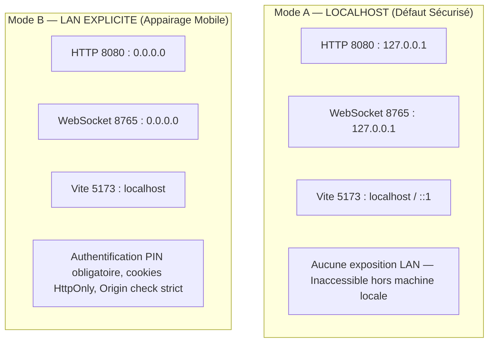

# 🛡️ ALICE-014 — NETWORK BINDING SECURITY REPORT
**Mission :** `ALICE-LOCAL-RUNTIME-REMEDIATION-014`  
**Constat traité :** `F013-02` (Serveurs HTTP et WebSocket liés à `0.0.0.0` par défaut)  
**Résultat :** RÉSOLU & SÉCURISÉ — DUAL-MODE LOCALHOST / LAN  
**Fichiers modifiés :**
- [main2.py](file:///c:/Users/USER/Desktop/Jarvis%20Final%20-%20SITE-V2/Jarvis%20Final%20-%20SITE/main2.py)
- [tests/test_remediation_014.py](file:///c:/Users/USER/Desktop/Jarvis%20Final%20-%20SITE-V2/tests/test_remediation_014.py)

---

## 1. Architecture des Modes de Liaison

Pour éliminer l'exposition accidentelle sur le réseau local tout en maintenant la possibilité d'utiliser l'application mobile sur le LAN, ALICE implémente deux modes explicites et distincts :

### 1.1 Mode A — LOCALHOST (Mode Sécurisé par Défaut)
- **Déclenchement :** `ALICE_BIND_MODE="LOCALHOST"`, `ALICE_LOCAL_ONLY="1"`, ou `ALICE_BIND_ADDRESS="127.0.0.1"`.
- **Liaison :**
  - Serveur HTTP Mobile : `127.0.0.1:8080`
  - Serveur WebSocket : `127.0.0.1:8765`
  - Frontend Vite : `localhost:5173`
- **Sécurité :** Aucun paquet externe n'est accepté. Le pare-feu Windows ne nécessite aucune règle entrante externe.

### 1.2 Mode B — LAN EXPLICITE (Accès Mobile Distant Autorisé)
- **Déclenchement :** `ALICE_BIND_MODE="LAN"`, `ALICE_LAN_ACCESS="1"`, ou `ALICE_BIND_ADDRESS="0.0.0.0"`.
- **Liaison :** `0.0.0.0:8080` et `0.0.0.0:8765`.
- **Garanties de Sécurité Préservées :**
  - Authentification obligatoire par PIN à usage unique (`PAIRING_MANAGER`).
  - Cookies de session durcis (`HttpOnly`, `SameSite=Strict`, `Max-Age=86400`).
  - Validation stricte de l'en-tête `Origin` (`WS_SESSION_MANAGER.is_origin_allowed`).
  - Contrôle RBAC complet par session.

---

## 2. Validation Automatisée

Les tests unitaires de binding ont validé :
1. `test_mode_a_localhost_via_bind_mode` : `http_host == "127.0.0.1"`, `ws_host == "127.0.0.1"`.
2. `test_mode_a_localhost_via_bind_address` : `http_host == "127.0.0.1"`, `ws_host == "127.0.0.1"`.
3. `test_mode_b_lan_via_bind_mode` : `http_host == "0.0.0.0"`, `ws_host == "0.0.0.0"`.
4. `test_mode_b_lan_via_lan_access_flag` : `http_host == "0.0.0.0"`, `ws_host == "0.0.0.0"`.
5. `test_default_network_config` (test historique 006) : rétro-compatibilité 100% conservée.
