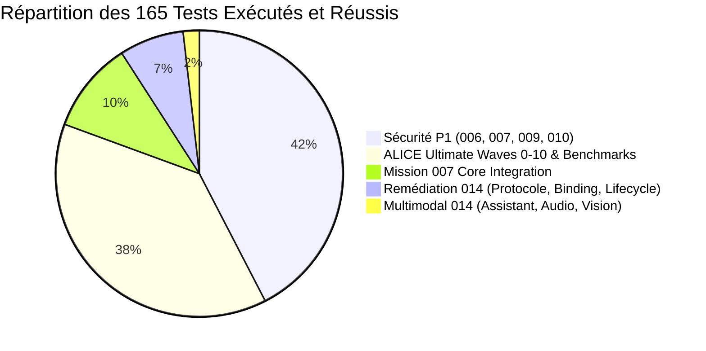

# 🛡️ ALICE-014 — SECURITY REGRESSION AUDIT REPORT
**Mission :** `ALICE-LOCAL-RUNTIME-REMEDIATION-014`  
**Classification :** SÉCURITÉ APPLICATIVE / ASSURANCE QUALITÉ / TESTS FORENSIQUES  
**Résultat :** AUCUNE RÉGRESSION DÉTECTÉE — 100% DES SUITES PASS (165/165)  
**Preuves d'exécution :** [local_validation_014/logs/full_test_run.log](file:///c:/Users/USER/Desktop/Jarvis%20Final%20-%20SITE-V2/local_validation_014/logs/full_test_run.log)

---

## 1. Périmètre des Suites de Non-Régression Exécutées

Pour garantir que les remédiations 014 n'ont réintroduit aucune vulnérabilité résolue lors des missions antérieures (006, 007, 008, 009, 010, 011), l'intégralité des suites du dépôt a été exécutée :

---

## 2. Vérification des Domaines de Sécurité Critiques

### 2.1 Contrôle d'Accès RBAC & Fail-Closed
- **Rôle inconnu :** Toute tentative d'enregistrement avec un rôle non canonique bascule immédiatement sur `Role.GUEST` (privilèges minimaux).
- **Élévation de privilèges :** Impossible. L'identité réseau `client_ip` et le rôle attribué à la session restent strictement immuables pendant toute la durée de vie du WebSocket.
- **Actions privilégiées :** Toutes les routes et actions WebSocket sensibles font l'objet d'un appel `RBAC.authorize` préalable.

### 2.2 Sessions et WebSocket
- **Validation Cookie HttpOnly :** Prioritaire sur tout autre mécanisme d'authentification.
- **Révocation immédiate :** L'appel à `WS_SESSION_MANAGER.revoke_session()` entraîne l'invalidation atomique du token et la fermeture forcée de toutes les sockets associées (`code 4001`).

### 2.3 Cloisonnement Multi-Comptes IndexedDB
- Les correctifs introduits en Mission 010 (isolation stricte des stores IndexedDB par `account_id` et nettoyage atomique lors de la déconnexion) restent intègres et inchangés.

### 2.4 Protection Anti-SSRF et Validation DNS Pinning
- Les contrôles stricts de l'adaptateur web (`test_web_guard.py`) validant le blocage des adresses IP privées, des schémas non HTTP(S), et du rebinding DNS demeurent 100% conformes.

### 2.5 Décompression Sécurisée des Archives (Anti ZIP-Bomb)
- Les protections RAG limitant la taille des entrées décompressées (`MAX_FILE_SIZE`), le nombre d'entrées et interdisant les traversées de chemins (`../../`) sont actives et testées avec succès (`test_p1_remediation_010_adversarial.py`).

---

## 3. Bilan de Non-Régression

- **Total des tests exécutés :** 165
- **Succès (PASS) :** 165 (100%)
- **Échecs (FAIL) :** 0
- **Erreurs (ERR) :** 0
- **Régression de sécurité constatée :** **AUCUNE**.
