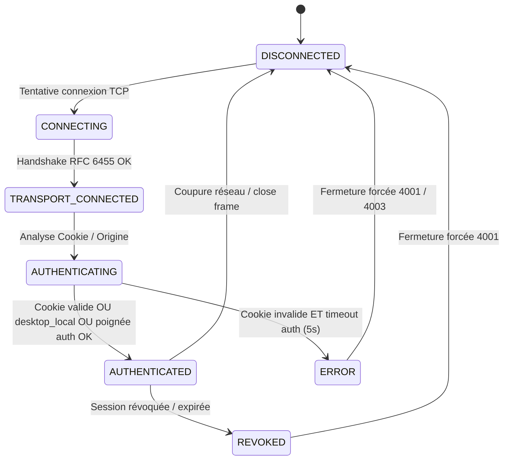

# 🛡️ ALICE-014 — WEBSOCKET PROTOCOL DESIGN SPECIFICATION
**Mission :** `ALICE-LOCAL-RUNTIME-REMEDIATION-014`  
**Classification :** ARCHITECTURE / PROTOCOLE RÉSEAU / SÉCURITÉ APPLICATIVE  
**Statut :** VALIDÉ & CONFORME RFC 6455  
**Fichiers concernés :** [main2.py](file:///c:/Users/USER/Desktop/Jarvis%20Final%20-%20SITE-V2/Jarvis%20Final%20-%20SITE/main2.py), [main.ts](file:///c:/Users/USER/Desktop/Jarvis%20Final%20-%20SITE-V2/Jarvis%20Final%20-%20SITE/frontend/src/main.ts), [app.js](file:///c:/Users/USER/Desktop/Jarvis%20Final%20-%20SITE-V2/Jarvis%20Final%20-%20SITE/mobile/app.js)

---

## 1. Analyse Architecturale & Rupture Précédente (F013-01)

Dans la mission 013, une contradiction majeure a été mise en évidence :
- L'interface Desktop Three.js affichait l'état `CONNECTÉ` dès l'événement DOM `ws.onopen`.
- L'interface Mobile PWA conditionnait son badge `CONNECTÉ` à la réception d'un message applicatif explicite `data.type === "auth_ok"`.
- Côté serveur backend (`main2.py`), la condition `is_direct_local_desktop` s'évaluait **avant** la vérification des cookies de session. Pour toute connexion sur l'interface de boucle locale `127.0.0.1`, le backend attribuait silencieusement `session_id = "desktop_local"` sans jamais émettre de message `auth_ok`.
- Par conséquent, lorsqu'un utilisateur ouvrait l'interface mobile sur `http://localhost:8080`, la socket TCP était établie, mais aucun message `auth_ok` n'était émis, maintenant l'interface mobile dans un état visuel trompeur `HORS-LIGNE`.

## 2. Modèle Formel des États de Connexion

Le protocole révisé 014 formalise 7 états mutuellement exclusifs pour tout client WebSocket :



1. **`DISCONNECTED`** : Aucune socket active. Badge : `HORS-LIGNE` / `reconnexion`.
2. **`CONNECTING`** : Négociation TCP / HTTP Upgrade en cours.
3. **`TRANSPORT_CONNECTED`** : Socket ouverte (RFC 6455), mais identité applicative NON encore confirmée. Badge : `authentification...`.
4. **`AUTHENTICATING`** : Évaluation du cookie `alice_session`, de l'origine et du handshake explicite.
5. **`AUTHENTICATED`** : Réception et acquittement de `auth_ok` contenant `session_id`, `role`, `user_id`. Badge : `connecté` (vert).
6. **`REVOKED`** : Session révoquée ou invalidée par RBAC. Fermeture socket code 4001. Badge : `session invalide`.
7. **`ERROR`** : Rejet d'origine (4003) ou échec d'authentification (4001).

## 3. Ordre Canonique d'Authentification Backend

Le gestionnaire `ws_handler` de `main2.py` applique désormais un ordre strict et fail-closed :

1. **Vérification Limite DoS / Concurrence** : Rejet 4008 si saturation.
2. **Vérification Origine (Anti-CSWSH)** : Rejet 4003 si origine inconnue.
3. **Priorité 1 — Cookie HttpOnly `alice_session`** :
   - Extrait le cookie `alice_session=<sid>:<token>`.
   - Si valide dans `WS_SESSION_MANAGER` :
     - Émission immédiate :
       ```json
       {
         "type": "auth_ok",
         "session_id": "<sid>",
         "role": "<ROLE>",
         "user_id": "<user_id>",
         "auth_method": "cookie",
         "message": "Authentification réussie via cookie sécurisé HttpOnly"
       }
       ```
4. **Priorité 2 — Console Locale Desktop (`desktop_local`)** :
   - Strictement restreint aux connexions directes non-proxy, sans en-tête de forwarding, sur loopback (`127.0.0.1` / `::1`), ET dont l'origine est `localhost:5173` ou interne.
   - Émission immédiate :
     ```json
     {
       "type": "auth_ok",
       "session_id": "desktop_local",
       "role": "OWNER",
       "user_id": "aboubakar",
       "auth_method": "desktop_local",
       "message": "Console locale autorisée"
     }
     ```
5. **Priorité 3 — Poignée de Main Explicite (Remote / Mobile non appairé)** :
   - Délai de garde strict de 5,0 secondes (`asyncio.wait_for`).
   - Attend un message JSON `{"type": "auth", "session_id": "...", "token": "..."}`.
   - Si valide : émission `auth_ok`.
   - Si invalide ou expiré : émission `auth_error` et clôture socket 4001.

---
*Rapport validé lors de la mission ALICE-014.*
